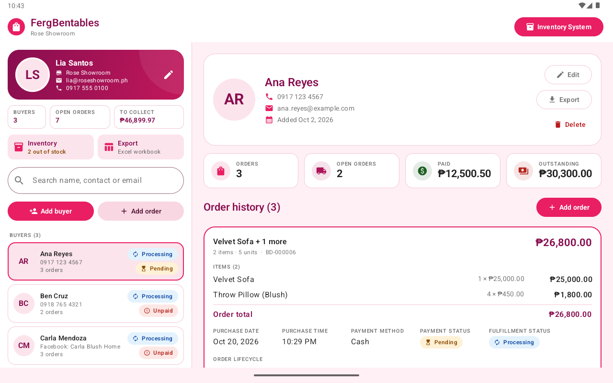
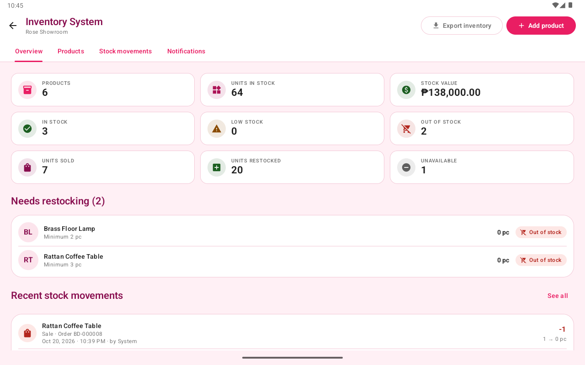
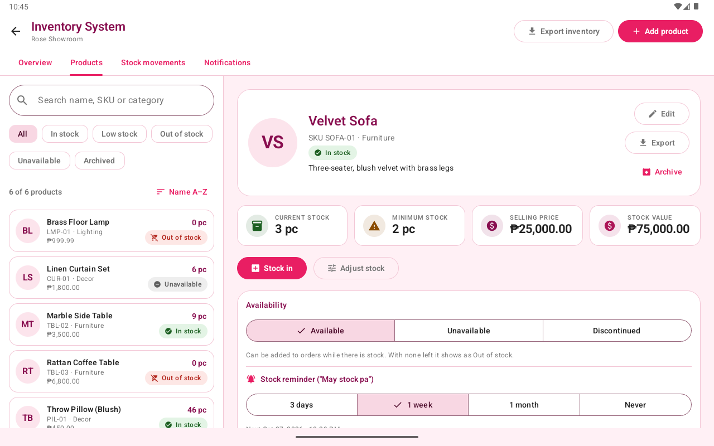
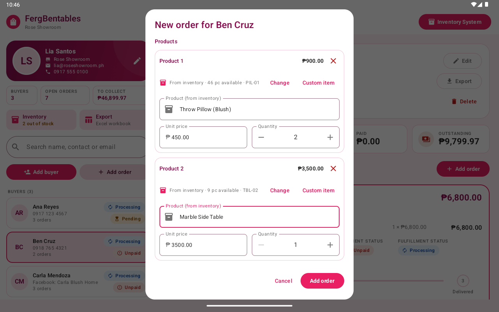
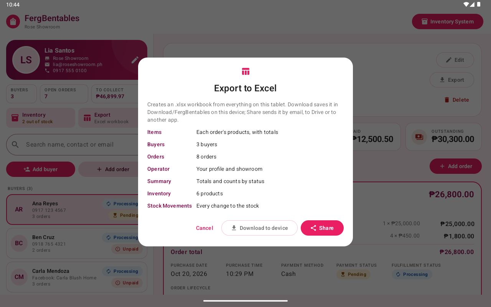

# FergBentables

An offline Android tablet app for running a showroom counter. It keeps a list of buyers, records
what they bought and every payment towards it (downpayments included), follows each order from
processing to delivery, prints an order slip or a paid receipt as a PDF, keeps the showroom's
inventory and exports everything to Excel. A Today view gathers what needs doing, the records can
be backed up to an encrypted file and restored, and a PIN can lock the app. The inventory covers
stock in, sales taken off the stock automatically, adjustments, a full movement history, stock
reminders and low-stock alerts. Built with Kotlin, Jetpack Compose (Material 3), Room and
WorkManager, with a custom pink design system.

The app started as BlushDesk. Only its package name, `com.blushdesk.app`, keeps that working
name. Changing the application id would make Android treat it as a different app,
so copies already in use could not be updated without losing their records.



## Features

**Top bar and operator profile.** The top bar switches between **Today** and **Buyers**, shows
how fresh the last backup is (green, or amber when one is due), opens the Inventory System, and
ends with the operator's photo or initials. That avatar opens a menu: Edit profile, Export to
Excel, Backup and restore, and PIN lock. The profile holds the tablet user's photo, full name,
showroom, email, phone number and the order number prefix. The app keeps one active profile. The
first launch asks for it, because every receipt carries it. The photo can be taken with the camera
or picked with the Android Photo Picker.

**Today.** One screen with what the counter has to get done:
- **To prepare or deliver**: every order not yet delivered, soonest delivery date first (orders
  without one by purchase date). A delivery date reads "Deliver today", "Deliver Nov 12, 2026",
  or, in red, "Delivery was due …".
- **To collect**: every buyer with a balance, largest first.
- **Running low**: products that are low or out of stock, with a button to the inventory.

A banner appears when a backup is due. Every row opens the buyer, the order or the inventory it is
about. On a wide screen the three lists sit side by side; on a narrow one they stack.

**Buyers.** Add, edit, search and delete buyers. A buyer has a full name, a contact number or a
Facebook name (at least one, or both), an optional email and a profile photo. The date added is set
automatically. Search matches the name, number, Facebook name or email.

The left pane starts with a strip of three figures (open orders, money to collect, stock), then
the search, then filter chips with counts: **All**, **Balance due** and **To deliver**. The list
sorts by name (A–Z) or by most due. Each row is compact: photo, name, contact (or "Facebook:
name") with the number of open orders, the amount still owed, and one payment chip. **Add buyer**
sits at the bottom of the pane.

Deleting a buyer deletes their orders too, after a confirmation. The confirmation also offers to
put back the stock those orders took from the inventory, which is ticked by default.

**Orders.** An order holds one or more products, up to 30. Each line has a product name, unit
price and quantity, on one row on a wide screen. The line total (unit price × quantity) and the
order total (the sum of the lines) are calculated as you type and are never typed in. A bar
pinned to the bottom of the form shows the order total, what is paid now, the balance and the
resulting status. An order also records the purchase date and time (pickers), the payment mode
(Cash or Online payment) and, optionally, a **downpayment** taken when the order is made. Money is
a `BigDecimal` with two decimals, stored as whole centavos, so totals never pick up rounding
errors. "Online payment" only records how the buyer paid. The app never makes a transaction.

A line can come from the inventory ("Choose from inventory") or be typed in as a custom item. A
picked line takes the product's name and price, and its quantity is capped at the stock on hand.
A custom item never touches the stock. See [Inventory System](#inventory-system) below.

Order numbers read like `BD-000012`. The prefix (1 to 4 letters or digits, starting with a letter)
is set in the operator profile. Each order keeps the prefix it was made with, so changing it later
does not renumber old receipts.

**Payments and balances.** An order's payment status is worked out from the payments recorded
against it, never set by hand:
- **Unpaid**: nothing paid yet
- **Partly paid**: a downpayment or part payment, with a balance left
- **Paid**: the payments cover the total

**Record payment** takes the amount (the balance by default, with "Full balance" and "Half"
shortcuts), how it was paid, the date and an optional note. An amount above the balance is
refused. **Mark as paid** records the rest of the balance in one tap. The order card lists every
payment with a progress bar, and a payment entered by mistake can be removed.

**Order history and lifecycle.** The buyer's orders are listed newest first; a multi-product
order reads "Velvet Sofa + 2 more". The selected order expands. Its actions sit at the top: Record
payment, Mark as paid, Move to the next stage, the PDF, edit and delete. Below them are the
payments panel, every product line, the purchase details, the delivery address and date, and a
Processing → Preparing → Delivered progress component. One tap on "Move to …" advances it a
single stage. Tapping a stage sets it directly. Delivered orders turn green.

**Undo.** Moving an order to another stage, marking it paid, recording a payment and removing a
payment each show a snackbar with **Undo**. Deletes keep their confirmation dialog instead.

**PDF order slips and receipts.** An order that is not fully paid gets an **Order slip**: the same
A4 layout titled ORDER SLIP, with a box showing the total, the amount paid and the balance due,
and no PAID stamp. A paid order gets the **Paid receipt**. The generator refuses a receipt for an
order that is not paid, and a slip for one that is. Both have:
- the showroom details (operator, store, email, phone)
- the buyer's details (name, contact number and/or Facebook name, email)
- one itemized row per product with unit price, quantity and line total; long orders continue
  on further pages under a compact header, with "Page x of y"
- purchase date and time, payment method, payment status and fulfillment status
- on the receipt, a semi-transparent PAID stamp

The PDF is written to the app's private cache, copied to `Download/FergBentables/`, and can be opened
(to print) or shared from the app.

**Backup and restore.** The tablet holds the shop's only copy of its records, so the app can save
everything (the database, photos included) to one encrypted `.fbk` file:
- **Back up** to `Download/FergBentables/`, or to any place the system file picker offers (a USB
  drive, a cloud drive app). The file is protected by a password of at least 6 characters, typed
  twice. The app never stores the password, so a lost password means the file cannot be opened.
- **Reminder**: every 3 days, weekly, or off. The top bar chip turns amber, and Today shows a
  banner, once a backup is due.
- **Restore** picks a backup file and asks for its password. A wrong password or a damaged file is
  refused before anything changes. A good one replaces every record on the tablet with the
  backup's, then restarts the app. If anything fails halfway, the current records are put back.
- The screen lists the last backups made.

The file is AES-256-GCM, written in 1 MB chunks, with the key derived from the password by
PBKDF2-HMAC-SHA256 (150,000 rounds, random salt). Each chunk is authenticated together with its
position and whether it is the last, so a truncated or reordered file is refused.

**PIN lock.** Optional, off by default, and turned on from the avatar menu. The PIN is 4 to 6
digits and is stored only as a salted PBKDF2 hash. Once on, the app asks for it when it starts and
after it has been in the background for 1, 5 or 15 minutes (the operator's choice). After 5 wrong
tries it waits 30 seconds before the next. A forgotten PIN cannot be recovered: clearing the app's
data removes it along with the records, which can then be restored from a backup. Changing the PIN
or turning the lock off asks for the current PIN.

### Inventory System

The **Inventory System** button in the top bar (where "Export to Excel" used to be) opens the
inventory. It has four tabs:

- **Overview.** Counts of products and units in stock, plus the stock value. Then how many
  products are in stock, low, out of stock or unavailable, and the units sold and restocked. Below
  those: the products that need restocking and the latest stock movements.
- **Products.** Search by name, SKU or category, with filters (In stock, Low stock, Out of stock,
  Unavailable, Archived) and sorting. A product's profile shows:
  - its stock, minimum, price and stock value
  - its availability and its stock reminder
  - every movement and every order that sold it

  From the profile the operator can do **Stock in**, **Adjust stock**, **Edit**, **Export**,
  **Archive** and **Delete**:
  - Stock in records a delivery: the quantity, date, supplier, reference and notes.
  - Adjust stock takes a reason: count correction, damaged, lost, found, customer return or other.
    It shows the stock after the change and never lets it go below zero.
- **Stock movements.** Every change to every quantity, filterable by type (stock in, sales,
  returns, adjustments). Each one shows the previous quantity, the change, the new quantity, the
  order or reason, and who made it.
- **Notifications.** The notification history, then each product's stock reminder setting.

A product has:
- a name
- an optional SKU, unique and case-insensitive
- a category and a description
- a selling price and an optional cost price
- a unit, `pc` by default
- a minimum stock
- a photo
- an availability: Available, Unavailable or Discontinued

Its stock status is worked out on every read and never stored. In order of precedence it is
Archived, Discontinued, Unavailable, Out of stock (0), Low stock (at or below the minimum), or In
stock. Only an Available product that is not archived can go on a new order.

Editing a product never changes its quantity. Stock only moves through Stock in, Adjust stock and
orders, so every change leaves a record. A product that has been sold can be archived but not
deleted, so old orders keep their link to it.

**Stock and orders.** Saving an order takes its inventory lines off the stock, in the same
database transaction as the order itself.
- Editing an order moves only the difference. Adding 2 more takes 2, and removing a line puts its
  stock back.
- Saving the same order again changes nothing, so stock is never taken twice.
- If any line asks for more than the stock on hand, the whole order is refused ("Insufficient
  stock. Only 3 pc of Velvet Sofa are available.") and nothing is saved.
- Deleting an order or a buyer asks whether to return the stock.

These changes are credited to "System" in the movement history. Deliveries and adjustments are
credited to the operator by name.

**Stock reminders and low-stock alerts** are two separate notifications:

- A **stock reminder** ("May stock pa ng Velvet Sofa: 3 pc left.") repeats every 3 days, every
  week or every month, set per product, or never. It pauses while the product is out of stock,
  archived or discontinued.
- A **low-stock alert** comes when a sale or adjustment takes a product to or below its minimum.
  It is sent once per dip and re-arms when the stock goes back above the minimum. Running out
  always sends one more ("Out of stock: Velvet Sofa").

Both appear in the app's notification history, and the unread count shows on the Inventory System
button. When the operator allows it, they also come as phone notifications that open that history.

A WorkManager job checks for due reminders every 6 hours and whenever the app opens. Each reminder
is keyed by product and due time, and a unique index refuses a second copy. A job that runs twice
therefore cannot send the same reminder twice. A reminder missed while the tablet was off is sent
once, not once for every period missed.

| Inventory overview | Product profile |
|---|---|
|  |  |

### Excel export

**Export to Excel** in the avatar menu opens a dialog. It lists what the full workbook
contains and offers two ways to get it:

- **Download to device** saves the `.xlsx` in `Download/FergBentables/`, where the Files app (or a
  computer on a USB cable) finds it. A dialog then names the file and can open it in the
  installed spreadsheet app.
- **Share** opens the Android share sheet (Gmail, Drive, Messenger, Quick Share, ...).

Both hand over the same formatted workbook:

| Sheet    | Columns / contents |
|----------|--------------------|
| Items    | Opens first. Each order's products as Product Name, Quantity, Price, Total Amount, newest order first, with an order total under each order (marked Paid or Not Yet Paid) and a grand total at the end |
| Buyers   | Buyer ID, Full Name, Contact Number, Facebook Name, Email, Date Added, Number of Orders, Payment Status |
| Orders   | One row per product line: Order ID, Buyer ID, Buyer Name, Product, Unit Price, Quantity, Total Amount (that line), Purchase Date, Purchase Time, Payment Mode, Payment Status, Fulfillment Status, plus Order Total, Amount Paid and Balance (for the whole order) |
| Operator | Operator Name, Store Name, Email, Phone Number |
| Summary  | Total Buyers, Total Orders, Paid / Unpaid / Partly Paid Orders, Processing / Preparing / Delivered Orders, Total Recorded Sales, then the inventory: products, units in stock, in stock / low / out of stock / unavailable products, stock value |
| Inventory | Product ID, SKU, Product Name, Category, Unit, Selling Price, Cost Price, Current Stock, Minimum Stock, Stock Status, Availability, Stock Value, Stock Reminder, Last Updated |
| Stock Movements | Date, Time, Product ID, SKU, Product, Movement, Previous Stock, Change, New Stock, Order, Reason / Notes, Supplier, Reference, Performed By |

The Items sheet was added to read orders on a tablet. Its totals are Excel formulas, so they
recalculate if someone edits a quantity or price. The app also stores each formula's result, so
previewers that never calculate (mail and Drive viewers) still show the numbers. The Orders sheet
keeps the specification's twelve columns. "Order Total" was added when orders gained several
products, "Amount Paid" and "Balance" when they gained payments, "Facebook Name" when buyers could
be reached on Facebook, and "Payment Status" so a printout shows who still owes: a buyer is Paid
once every order is paid, Not Yet Paid while any order is Unpaid or Partly paid, and "No orders"
before their first order. Headers are styled and
frozen, the Buyers and Orders tables have filters, money uses a peso currency format, dates and
times are real Excel dates, and status cells are color coded.

Three smaller workbooks come from the profiles. Each is named after what it holds and the date, and
offers the same Download and Share choices:

| Export from | File name | Sheets |
|---|---|---|
| A buyer's profile (Export) | `Ana_Reyes_Profile_2026-10-20.xlsx` | Profile, Items, Orders |
| A product's profile (Export) | `Velvet_Sofa_Inventory_2026-10-20.xlsx` | Product, Stock Movements, Sales |
| The Inventory System (Export inventory) | `Inventory_Report_2026-10-20.xlsx` | Inventory, Stock Movements, Summary (adds archived products, stock value at cost, units sold and units restocked) |

The file is a plain ZIP: every part carries its size and checksum in its own header, the way Excel
saves files. Apache POI streams the parts instead, leaving those fields empty. Desktop Excel
accepts that, but Excel for Android refuses such a file and calls it password-protected.

These screenshots predate the 1.3 redesign (Today, payments, backups); the export dialog and
receipt still look the same.

| New order with several products | Export dialog | Paid receipt | Share sheet |
|---|---|---|---|
|  |  |  |  |

**Layout.** The app is designed for a landscape tablet: buyers on the left, the selected buyer's
dashboard on the right. Windows narrower than 600dp (phone, split screen) switch to one pane at a
time with a back arrow. This matters because Android 16+ ignores orientation locks on large
screens. An open form keeps what was typed when Android recreates the screen (a display-size
change) or closes the app in the background. The selected buyer and order come back too. Once
something has been typed, Back and Cancel ask "Discard changes?" before closing the form. With a
floating keyboard, Back closes the form rather than the keyboard, so this guards against losing a
half-entered order by accident.

**Errors.** Messages are written for the operator. A broken rule, such as "Enter a valid phone
number" or "Mark the order as paid before issuing a receipt", is shown as written. Any other
failure is logged and replaced by a generic message, so raw database or library errors never
reach the screen. Error snackbars use the error colors and an icon.

## Offline by design

There is no Firebase, back end, REST API, login or cloud sync, and the manifest does not declare
the `INTERNET` permission. Everything is stored in a local Room database, and the app works the
same in airplane mode.

## Tech stack

| Area | Choice |
|---|---|
| Language | Kotlin 2.4, coroutines and Flow |
| UI | Jetpack Compose, Material 3 (Compose BOM 2026.09) |
| Architecture | MVVM with a repository (interface in `domain`, Room implementation in `data`), a small hand-written dependency container |
| Database | Room 2.8 (KSP): entities, DAO, type converters, relations, exported schemas and tested migrations |
| Excel | Apache POI 5.5 (`poi-ooxml`) |
| PDF | Android's built-in `PdfDocument` canvas |
| Images | Coil 3, `ExifInterface` |
| Background work | WorkManager 2.12 (stock reminders) |
| Build | AGP 9.4, Gradle 9.8, compileSdk 37, targetSdk 37, minSdk 29 (Android 10) |

## Project structure

```
app/src/main/java/com/blushdesk/app/
├── data/
│   ├── backup/           BackupCrypto (encrypted file format), BackupArchive, BackupService
│   │                     (create, save, restore), BackupStore (history, reminder), BackupPassword
│   ├── security/         PinLock (PIN hash, lock timing, wrong-try wait)
│   ├── local/database/   AppDatabase, ShowroomDao, InventoryDao, Entities (OperatorProfile, Buyer,
│   │                     Order, OrderItem, Payment, Product, StockMovement, InventoryNotification),
│   │                     Relations (BuyerWithOrders, OpenOrder, ...), Converters, Migrations
│   └── repository/       OfflineShowroomRepository, OfflineInventoryRepository (Room),
│                         InventoryLedger (the only code that changes a quantity)
├── domain/
│   ├── model/            Enums (PaymentMode, PaymentStatus, FulfillmentStatus), Inventory (Availability,
│   │                     StockStatus, MovementType, AdjustmentReason, ReminderInterval), BuyerDetail,
│   │                     ExportSnapshot (+ BuyerReport, ProductReport, InventoryReport), UserFacingException
│   └── repository/       ShowroomRepository, InventoryRepository (interfaces)
├── notifications/        InventoryNotifier (phone notifications), ReminderWorker (WorkManager job)
├── ui/
│   ├── AppRoot.kt        switches between the showroom and the inventory, keeping each one's state
│   ├── theme/            ShowroomPinkTheme: Color, Type, Shape, Dimens, Theme
│   ├── components/       BuyerList, BuyerListItem, SearchBar, OrderCard, OrderStatusBadge
│   │                     (+ FulfillmentProgress), PaymentStatusBadge, StatCard, EmptyState,
│   │                     LoadingIndicator, ShowroomSnackbar (with Undo), FormDialog, ...
│   ├── showroom/         ShowroomTabletScreen (top bar, avatar menu), ShowroomViewModel,
│   │                     ShowroomUiState, MasterPane, BuyerFilters, TodayScreen
│   ├── inventory/        InventoryScreen, InventoryViewModel, InventoryUiState, InventoryOverview,
│   │                     InventoryTabs, ProductProfile, ProductFormDialog, StockDialogs, InventoryRows
│   ├── buyer/            AddBuyerDialog, EditBuyerDialog, BuyerDetailScreen, BuyerDetailHeader
│   ├── order/            AddOrderDialog, EditOrderDialog, OrderDetailCard, OrderHistory,
│   │                     RecordPaymentDialog, DeliveryDialog, ReceiptReadyDialog
│   ├── backup/           BackupScreen, BackupViewModel
│   ├── security/         LockScreen, PinSettingsDialog
│   ├── operator/         EditOperatorProfileDialog
│   └── export/           ExportDialog, ExportChoiceDialog
├── utils/                PdfReceiptGenerator, ExcelExporter, DocumentService, Money, Payments,
│                         Validation, Formats, PhotoStorage, DownloadsSaver, AppFiles, Sharing
├── di/                   AppContainer
└── MainActivity.kt, FergBentablesApp.kt
```

Data flows one way. Room emits `Flow`s, `ShowroomViewModel` and `InventoryViewModel` each combine
them into one immutable UI state, and the screens render that state and call view model functions.
Composables never touch the database. One-off results (success, error, "receipt ready", "share
this workbook") arrive as events. The view model depends only on interfaces, so its unit tests
run on the JVM with fakes.

### Database

```
operator_profile (one active row)   buyers 1 ──── * orders 1 ──────────────── * order_items
  fullName, storeName, email,          id, fullName,           id, buyerId (FK, CASCADE),     id, orderId (FK, CASCADE),
  phoneNumber, profileImageUri,        contactNumber,          totalAmount, purchaseDateTime, position, productName,
  orderPrefix,                         facebookName, email,    paymentMode, paymentStatus,    unitPrice, quantity,
  createdAt, updatedAt                 dateAdded,              fulfillmentStatus,             lineTotal
                                       profileImageUri,        numberPrefix, deliveryAddress,
                                       createdAt, updatedAt    deliveryDate,
                                                               createdAt, updatedAt
                                                                 1
                                                                 │
                                                                 * payments
                                                               id, orderId (FK, CASCADE), amount,
                                                               paidAt, paymentMode, note, createdAt

products 1 ──── * stock_movements            products 1 ──── * inventory_notifications
  id, sku (unique), name, category,            id, productId (FK, CASCADE),     id, productId (FK, CASCADE),
  description, sellingPrice, costPrice,        type, previousQuantity, change,  kind, title, message,
  quantity, minimumStock, unit,                newQuantity, orderId, reason,    dedupKey (unique),
  availability, archived, imageUri,            supplier, reference,             createdAt, readAt, postedAt
  reminderInterval, reminderLastSentAt,        performedBy, occurredAt,
  reminderNextAt, lowStockAlerted,             createdAt
  createdAt, updatedAt                       order_items.productId → products (FK, RESTRICT; NULL for a custom item)
```

- Money is `BigDecimal` in code and centavos (INTEGER) in SQLite, so SQL `SUM()` is exact. A third
  decimal is rejected, never rounded.
- `lineTotal` (unit price × quantity) and `totalAmount` (sum of lines) are stored for reporting
  but recomputed on every save. An order and its lines are written in one transaction, and editing
  an order replaces its lines. `createdAt` / `updatedAt` are stamped by the repository.
- An order's `paymentStatus` is kept in step with its payments by the repository: it is
  recomputed whenever a payment is added or removed and whenever the order is edited. Totals ("To
  collect", a buyer's balance) are summed from `payments`, capping each order's paid amount at its
  total, so an order edited down after it was paid never counts as overpaid. The enum value
  `PENDING` is kept for old rows and backups and is shown as "Partly paid".
- Enums are stored by name, so reordering them cannot relabel old rows.
- The DAO has explicit queries for:
  - CRUD
  - search
  - observing buyers, the selected buyer and their orders
  - order totals
  - orders by payment status and by fulfillment status
  - the export data
- Every quantity change goes through `InventoryLedger`, which writes the new quantity and its
  `stock_movements` row together inside the caller's transaction. A refusal (not enough stock)
  throws, and the whole order or delivery around it rolls back.
- The schema is exported to `app/schemas/`. Five hand-written migrations are tested with Room's
  `MigrationTestHelper`:
  - version 1 → 2 moved to this specification's field names
  - version 2 → 3 moved products into `order_items`; each old order becomes an order with one line
  - version 3 → 4 added `facebookName`; existing buyers keep their number and get an empty one
  - version 4 → 5 added the three inventory tables and `order_items.productId`; existing order lines
    are kept as custom items (no product link), so no stock is taken for past sales
  - version 5 → 6 added `payments`, the delivery address and date, and the order number prefix
    (`BD` for every existing order and profile). Each order already marked Paid gets one payment of
    its total, dated when it was last updated, with the note "Marked as paid before payments were
    recorded". Orders marked Pending had no amount recorded, so they become Unpaid.
- There is deliberately no destructive fallback: this is the shop's only copy of its records.

## Permissions, files and privacy

The only runtime permission is **notifications** (`POST_NOTIFICATIONS`, Android 13+). It is asked
the first time a stock reminder is turned on, and the Notifications tab offers it again while it
is off. Refusing it loses nothing: reminders and alerts still appear in the app's notification
history.

The other entries in the built APK are install-time permissions that users are never asked about:
- WorkManager adds `WAKE_LOCK`, `RECEIVE_BOOT_COMPLETED` (to reschedule the reminder job after a
  restart), `ACCESS_NETWORK_STATE` and `FOREGROUND_SERVICE`. The reminder job uses neither the
  network nor a foreground service.
- androidx.core adds `DYNAMIC_RECEIVER_NOT_EXPORTED_PERMISSION`, which is signature-level and
  private to the app.

- **Gallery photos** come through the Photo Picker, so the user hands over one image.
- **Camera photos** are taken by the device's camera app, which writes to a FileProvider URI.
  The app never needs the `CAMERA` permission.
- **Receipts, order slips, downloaded Excel files and backups** are copied into Downloads through MediaStore, which needs no storage permission on Android 10+.
- **Backups saved elsewhere, and restores,** go through the system file picker, so the app only
  ever sees the one file the operator picks.
- **Sharing** uses `content://` URIs from a FileProvider, and `res/xml/file_paths.xml` exposes
  only the `receipts/`, `exports/` and `camera/` cache folders. A test checks that anything else,
  including the database, is refused.
- **Photos** are downsized (longest edge 1024 px) and kept in private storage. Replaced or
  abandoned photos are deleted.
- **Android's automatic backups** are off, both cloud and device-to-device, because the database
  holds customers' personal details. The app's own backup is an encrypted file that goes only
  where the operator saves it.
- **The PIN** is kept as a salted PBKDF2 hash in the app's private storage, never as the digits.

## Design system

`ShowroomPinkTheme` builds a Material 3 color scheme from the brand palette:
- Soft Pink `#FCE4EC`
- Vibrant Rose `#E91E63`
- Deep Magenta `#880E4F`
- Lavender Blush `#FFF0F5`
- White
- dark text `#212121`
- muted text `#757575`

Colors, typography, shapes and dimensions live in `ui/theme`; composables do not hard-code them.

`#757575` falls below the 4.5:1 contrast minimum on the pink surfaces. Gray text placed on pink
uses a darker on-tint variant (`#666666`), and the master pane is white.

White text on Vibrant Rose is 4.3:1, also under 4.5:1 for small text. Filled buttons and pink
text therefore use Rose Deep `#C2185B` (5.9:1). Vibrant Rose stays for accents, the receipt and
the logo.

Status badges pair color with an icon and a word, so they are readable without telling colors apart.

## Building and running

Requirements: Android Studio (its bundled JDK works; tested with JBR 25) and the Android SDK with
platform 37 installed.

```bash
./gradlew :app:assembleDebug        # build the APK
./gradlew :app:installDebug         # install on a running emulator or device
```

For the intended experience use a tablet emulator in landscape (for example a 10.1" WXGA profile).
On first launch the app asks for the operator's profile.

### Release build

Release builds are shrunk with R8, which brings the APK from about 70 MB down to about 13 MB. They
are signed when a `keystore.properties` file sits at the project root.

1. Create a signing key once. Keep the key file and its password safe: an installed release can
   only be updated by an APK signed with the same key. `keytool` comes with Android Studio's JDK.

   ```bash
   keytool -genkeypair -keystore ~/.android/blushdesk-release.jks -storetype PKCS12 -alias blushdesk -keyalg RSA -keysize 4096 -validity 10000
   ```

2. Copy `keystore.properties.example` to `keystore.properties` and fill it in. Git ignores
   `keystore.properties` and every `*.jks` / `*.keystore` file.
3. Build:

   ```bash
   ./gradlew :app:assembleRelease      # app/build/outputs/apk/release/app-release.apk
   ```

Without `keystore.properties` the same command still builds, but the APK is unsigned.

Apache POI loads schema classes and data files by name, so `app/proguard-rules.pro` tells R8
what to keep. A missing rule does not fail the build. It shows up only when the app runs, as
"Couldn't create the Excel file", with the cause in logcat. After changing dependencies or those
rules, install the release APK and do an Excel export and a receipt before shipping it.

## Tests

```bash
./gradlew :app:testDebugUnitTest            # 129 JVM tests, no device needed
./gradlew :app:connectedDebugAndroidTest    # 121 tests on a running emulator or device
```

- **Unit tests:**
  - money (parsing, totals, centavos), validation, date formats, enums and converters, LIKE escaping
  - the Excel workbook (sheets, exact columns, values, formats, the Items formulas and their stored
    results, the plain ZIP layout; POI on the JVM)
  - the theme's color initialization
  - the view model against fakes: selection (including after the app is closed in the background), order expansion, totals, lifecycle, deletes, friendly errors, exports, downpayments, payments above the balance refused, and Undo for marking paid and for a stage move
  - payments: status from what was paid, the balance never below zero, the amount rules, order number prefixes
  - backups: the encrypted file round-trips, and a wrong password, another kind of file, a cut-short file or a changed byte is refused; the archive accepts only the expected file names
  - the PIN lock: the PIN rules, the salted hash, and when the app locks
  - the buyer filters and sorts
  - the inventory rules: stock status and its precedence, reminder dates (month ends, time zones), the product and stock-form validation, the inventory filters and searches, and the buyer, product and inventory workbooks
- **Instrumented tests:**
  - every DAO query on real SQLite (cascade delete, foreign keys, latest-order status, totals, status lists, export summary, search with `%` and `_`)
  - the v1 → v2 → v3 → v4 → v5 → v6 migrations, including the payment given to each order that was already paid
  - totals from payments, with an order edited down after it was paid never counted as overpaid
  - the repository rules (recomputed totals, timestamps, validation, photo cleanup)
  - the inventory on real SQLite:
    - a sale takes stock and records a movement
    - overselling is refused with nothing saved
    - saving an order twice takes stock once, and editing moves only the difference
    - deleting an order or buyer returns stock when asked
    - unsellable products are refused
    - stock in and adjustments
    - archive versus delete
    - low-stock alerts once per dip, and again on running out
    - reminders due once per slot, never twice for the same slot
  - the notifier: a due reminder becomes one phone notification, low-stock alerts use their own channel, and the WorkManager job is scheduled and runs
  - Apache POI on Android's runtime, formula results included
  - PDF generation rendered back to pixels
  - photo import, Downloads saving (receipts and the workbook, byte for byte), order slips, FileProvider rules
  - the screens, with Compose UI tests:
    - the order form: a new line scrolls into view with the cursor in it, totals follow what is typed, saving hands over every line
    - closing a form: an untouched or unchanged form closes at once; one with typed input asks first, and "Keep editing" keeps it
    - the buyer form: a contact number or a Facebook name
    - the export dialog: Download to device and Share as separate choices, both held back while the workbook is made or when there is nothing to export, and the "saved" dialog naming the file and folder
    - the whole screen keeping an open form and what was typed when it is recreated
    - the inventory: the Inventory System button and Export to Excel in the avatar menu, a duplicate SKU caught while typing, the order form's inventory picker stopping at the stock on hand, an adjustment that cannot go below zero, and adding a product and stocking it in

The PDF test writes PNG renders of each receipt to the app's `files/test-artifacts/` so a person
can look at the output.

## Configuration

- **Currency:** `Money.SYMBOL` in `utils/Money.kt` (peso by default). The PDF and Excel formats follow it.
- **Brand colors:** `BrandPalette` in `ui/theme/Color.kt` feeds the Compose theme, the PDF and the Excel styles.
- **Logo:** `docs/logo/fergbentables-logo.svg` is the bow-and-doily artwork, drawn as vectors with the
  lettering as outlines. The launcher icon's foreground and themed-icon layers (`mipmap-*`), the
  Android 12+ splash logo (`drawable-*/splash_logo.png`) and `app/src/main/ferglogo-playstore.png`
  are PNGs rendered from it for each screen density.

## Known limitations

- **Reminders are not to the minute.** Android runs the reminder job about every 6 hours, and
  later when the tablet is idle (Doze), so a reminder can arrive several hours after it is due. It
  is also checked whenever the app opens. Low-stock alerts are not affected: they are raised the
  moment the stock changes.
- **One operator, no accounts.** The app has no login or roles, by design (see
  [Offline by design](#offline-by-design)). "Performed by" in the movement history records the
  operator's name from the profile, and "System" for changes made by orders.
- **One tablet.** Stock lives on this tablet only. Two tablets would each keep their own count.
- **Backups are made by hand.** The app reminds the operator, but nothing leaves the tablet on its
  own, and a restore replaces the records rather than merging them: anything entered after that
  backup is gone. The restore dialog says so before it starts.
- **The PIN lock is a screen lock, not encryption.** It keeps someone who picks up the tablet out
  of the app. The records stay in the app's private storage as before, protected by Android's app
  sandbox and the device's own encryption.
- **The release build is checked by hand.** The automated tests run against the debug build. The
  shrunk, signed release build was checked on the emulator: profile, buyers (including one reached
  only on Facebook), a multi-product order, receipt, sharing, Excel export (pulled off the device
  and checked on a PC, formula results included) and photo import.

  For 1.2.0 it was installed over 1.1.4 on a phone emulator, and these were checked:
  - the existing buyer and order came through the migration
  - the reminder job ran under R8
  - adding a product and turning on a reminder, which asked for the notification permission
  - selling from stock, which raised a low-stock phone notification

  1.3.0 has so far been checked on the debug build only, installed over the earlier version on the
  tablet emulator. The data came through the migration, and these worked: Today, the filters, a
  partial payment with Undo, an order slip, a backup to Downloads, a refused wrong-password
  restore, a full restore with restart, and the PIN lock. Do the release check above before
  shipping it.
- **Excel for Android itself is untested here.** The emulator has no signed-in Play Store, so the
  "password-protected" fix was checked against the file format (every ZIP header filled in, as
  Excel writes them), not by opening the file in Excel for Android.
- **Light theme only**, on purpose: the pink palette is the brand.
- **Test coverage:** tested on an Android 15 (API 35) tablet emulator, not yet on an Android 16+
  device or real hardware.
